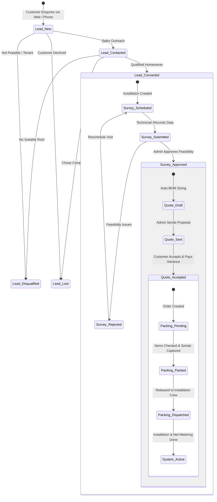

# Domain Models & Business Workflows

This document details the business domain entities, state lifecycles, Bill of Materials (BOM) formulas, and Indian market localization rules implemented across the Sol platform.

---

## 1. Core Domain Entities

### 1.1 Lead (`Domain.Entities.Lead`)
Represents an incoming enquiry from the public website or telephone intake.
- **Identifier:** Integer `Id`.
- **Contact Details:** `FirstName`, `LastName`, `Email`, `PhoneNumber`.
- **Property Details:** References `Address` entity; includes `PropertyType` (House, Apartment, Commercial) and `IsPropertyOwner` boolean.
- **Qualification:** `MonthlyBillRange` (e.g. `₹1,500 – ₹3,000`), `BestTimeToContact`, and customer `Notes`.
- **Lifecycle State:** `Status` (`LeadStatus`: `New`, `Contacted`, `Converted`, `Disqualified`, `Lost`).
- **Timing:** `CreatedAt`, `ContactedAt`, `ClosedAt`.

### 1.2 Customer (`Domain.Entities.Customer`)
Represents a homeowner who has converted from an enquiry into an active account.
- **Identifier:** Integer `Id`.
- **Identification:** `Email`, `NormalizedEmail` (trimmed, lowercase for invariant deduplication).
- **Security:** `PasswordHash` (optional; customer can use passwordless OTP or set a password).
- **Status:** `CustomerStatus` (`Prospect`, `Customer`).
- **Timestamps:** `RegistrationDate`, `LastLoginAt`, `SessionsValidFrom`.
- **Relationships:** Has many `Installations`.

### 1.3 Installation (`Domain.Entities.Installation`)
The central operational anchor linking the customer, property, site surveys, quotations, packing orders, and physical installation.
- **Identifier:** Integer `Id`.
- **Links:** `CustomerId`, `AddressId`, `LeadId`.
- **Status:** `InstallationStatus` (`Survey`, `Design`, `Quotation`, `Installation`, `Active`, `Closed`).
- **Time Zone:** IANA time zone identifier (defaulting to `Asia/Kolkata` for Indian sites).
- **Relationships:** Has many `Quotes`, `PackingOrders`, and `Surveys`.

### 1.4 Survey (`Domain.Entities.Survey`)
A physical site visit performed by an assigned technician to collect structural and electrical data.
- **Identifier:** Integer `Id`.
- **Assignments:** `TechnicianId` (`Domain.Entities.User`), `CreatedById`.
- **Status:** `SurveyStatus` (`Scheduled`, `Submitted`, `Approved`, `Rejected`).
- **Measurements:**
  - `ShadowFreeRoofAreaSquareMetres`: Net usable rooftop area without shading.
  - `MonthlyBillRupees`: Average monthly electric utility bill.
  - `GridSuitable`: Boolean indicating utility grid stability and net-metering feasibility.
  - `RoofDirectionDegrees`: Azimuth orientation (0° = North, 180° = South).
  - `RoofTiltDegrees`: Slope angle of roof structure.
  - `CableDistanceMetres`: Physical route length between roof panels and main distribution panel.
- **Review:** `ReviewedById`, `ReviewedAt`, `ReviewNotes`.
- **Concurrency:** `Version` counter incremented on every state mutation.

### 1.5 Quote (`Domain.Entities.Quote`)
The commercial and technical proposal presented to the customer.
- **Identifier:** Integer `Id`.
- **Sizing:** `SystemCapacityKw` (typically 1.0 kW to 5.0 kW).
- **System Type:** `SolarSystemType` (`OnGrid` vs. `OffGrid`).
- **Financials:**
  - `BasePriceRupees`: Hardware BOM sum + turnkey installation cost.
  - `EstimatedSubsidyRupees`: PM Surya Ghar central government financial assistance.
  - `TotalAmountRupees`: Net customer payable (`BasePriceRupees - EstimatedSubsidyRupees`).
  - `AdvancePercentage`: Required deposit (default 20%).
  - `AdvanceRequiredRupees`: Calculated 20% advance amount.
  - `AmountPaidRupees`: Cumulative payments received.
- **Status:** `QuoteStatus` (`Draft`, `Sent`, `Accepted`, `Rejected`, `Expired`).
- **Payment Status:** `PaymentStatus` (`Pending`, `AdvancePaid`, `FullyPaid`).
- **Relationships:** Contains collection of `QuoteItem` records.

### 1.6 PackingOrder & PackingOrderItem (`Domain.Entities.PackingOrder`)
The warehouse fulfillment order generated automatically upon customer quote acceptance and advance payment.
- **Identifier:** Integer `Id`.
- **Status:** `PackingStatus` (`Pending`, `Packed`, `Dispatched`).
- **Items:**
  - `ItemName`, `Category` (`BOMCategory`), `Quantity`, `Unit`.
  - `IsPacked`: Checkbox verified by warehouse staff.
  - `RequiresSerialNumber`: True for serialized components (`Inverter`, `Battery`, `ChargeController`).
  - `SerialNumber`: Physical barcode or serial scanned before dispatch.

---

## 2. Business Workflows & State Machines

### 2.1 The Gated Quoting Invariant
- **Rule:** A quotation cannot be generated or dispatched to a customer until the site survey for that installation has reached `Approved` status (`QuoteErrors.SurveyNotApproved`).
- **Enforcement:** Enforced in `QuoteService.GenerateOrUpdateAsync` and verified in backend integration tests.

### 2.2 Sizing & Bill of Materials (BOM) Calculation Engine
The `QuoteTemplateEngine` implements realistic photovoltaic engineering formulas:

1. **Capacity Sizing:**
   - If requested capacity is between 1.0 kW and 5.0 kW, it is respected.
   - Otherwise, capacity is derived from monthly utility bill:
     - Bill < ₹1,500 → 1.0 kW
     - Bill < ₹2,500 → 2.0 kW
     - Bill < ₹4,000 → 3.0 kW
     - Bill < ₹5,500 → 4.0 kW
     - Bill ≥ ₹5,500 → 5.0 kW
   - Roof area check: Ensures roof has at least 8 m² of shadow-free area per kilowatt.
2. **Bill of Materials Line Items:**
   - **Solar Panels:** 550W Half-Cut Mono-PERC modules (balanced in pairs). Unit cost: ₹11,000 each.
   - **Inverter:** Sized to capacity (1.5 kVA to 5.5 kVA), string grid-tie for On-Grid, pure sine wave hybrid for Off-Grid.
   - **Battery & Charge Controller (Off-Grid only):** LiFePO4 modular battery bank (2.5 kWh per kW) + 48V MPPT charge controller.
   - **Mounting Structure:** Elevated hot-dip galvanized steel rated for 150 km/h winds, customized to survey roof tilt.
   - **Cabling:** UV-resistant cross-linked DC cables + armoured AC cables calculated as `Math.Max(25, (CableDistanceMetres * 2) + 10)`.
   - **Distribution & Safety:** 1000V DC combiner box with Type 2 SPD + AC distribution box with RCCB and surge protection.
   - **Earthing & Lightning:** Dual chemical earthing pits with copper-bonded electrodes + Class A lightning arrester.
   - **Turnkey Service:** Mechanical assembly, stringing, generation verification, net-metering liaison, and DISCOM signoff.

3. **Government Subsidy Logic (PM Surya Ghar Muft Bijli Yojana):**
   - On-Grid systems receive central rooftop subsidy:
     - 1.0 kW: ₹30,000
     - 2.0 kW: ₹60,000
     - 3.0 kW and above: ₹78,000 (statutory ceiling)
   - Off-grid systems do not receive central grid subsidy.

---

## 3. Indian Market Localization

1. **Currency:** Stored in native Indian Rupees (INR, ₹).
2. **Geography:** Validated against ISO 3166-2:IN codes representing all 28 Indian States and 8 Union Territories (`IndiaStates.cs`).
3. **Time Zone:** Default timezone configured as `Asia/Kolkata` (IST, UTC+05:30).
4. **Billing Slabs:** Marketing lead form reflects standard Indian residential power consumption slabs:
   - Under ₹1,500 / month
   - ₹1,500 – ₹3,000 / month
   - ₹3,000 – ₹6,000 / month
   - ₹6,000 – ₹10,000 / month
   - Over ₹10,000 / month
